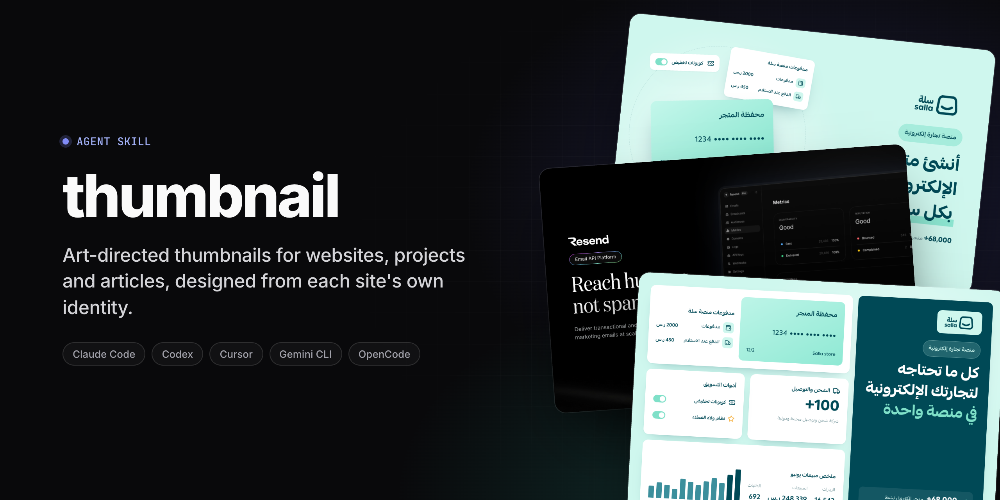
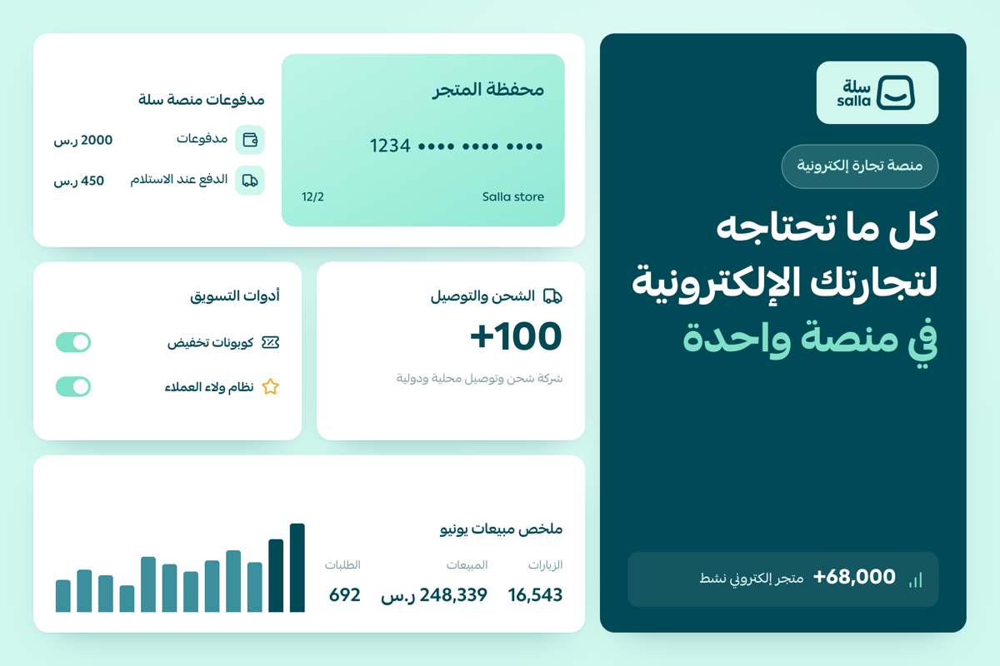
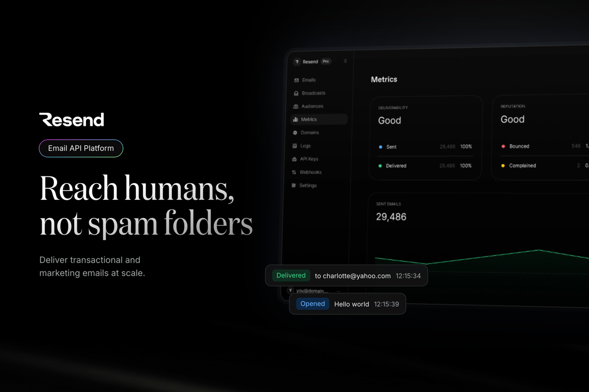
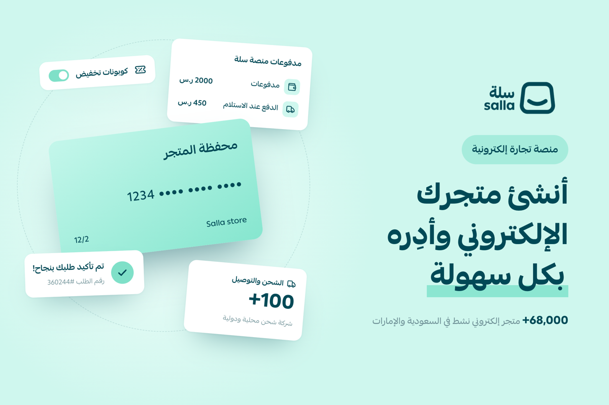
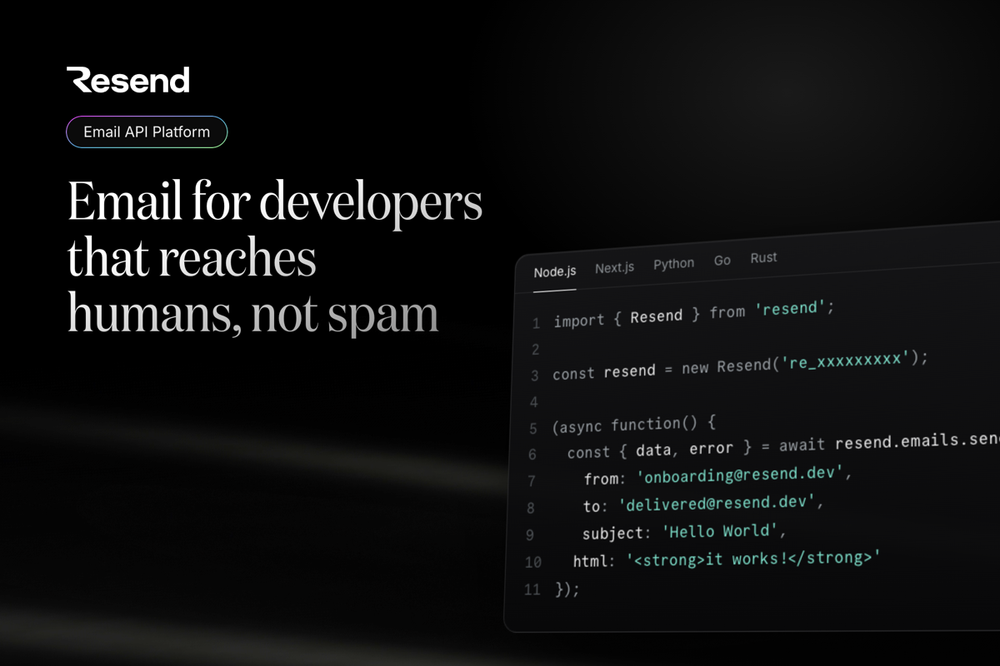
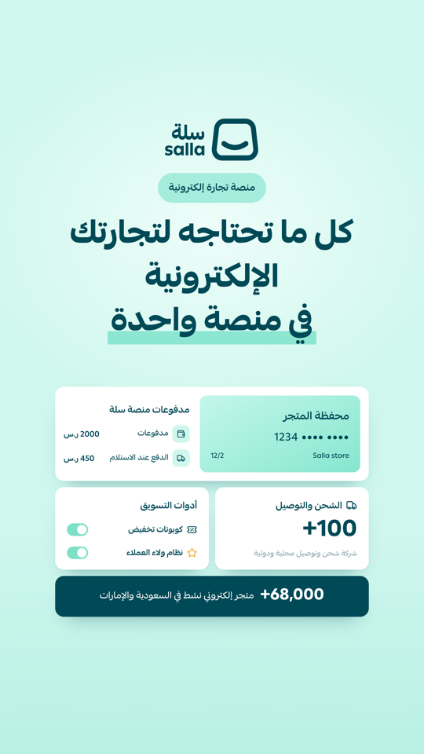
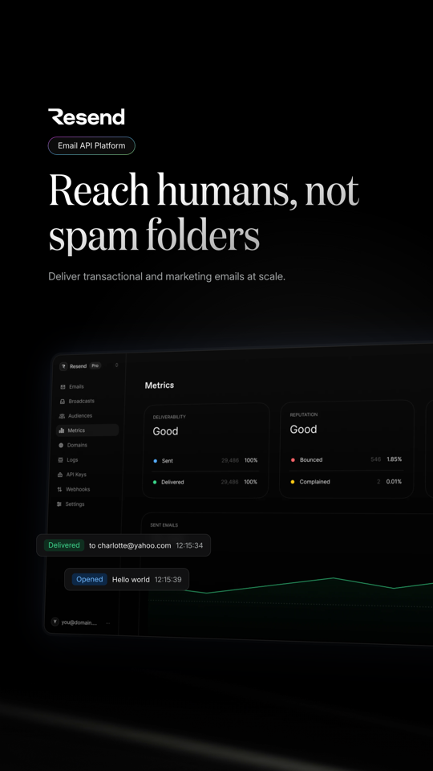
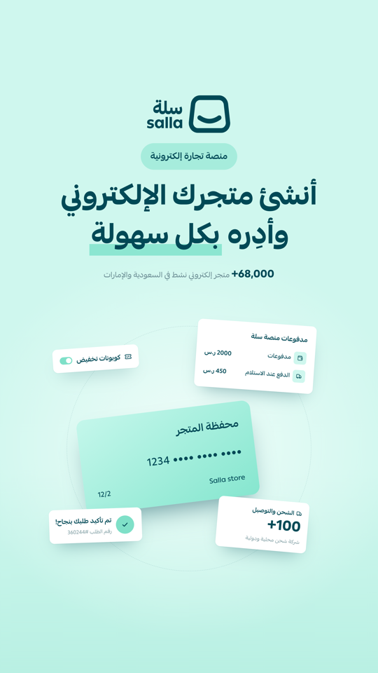
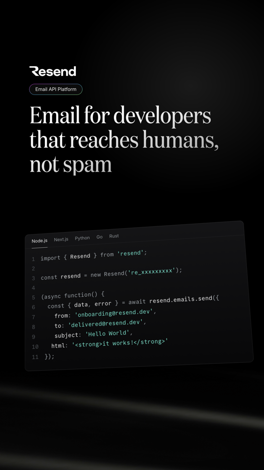

<p align="center">
  
</p>

<p align="center">
  <a href="https://github.com/aeentech/thumbnail-skill/releases/latest"></a>
  <a href="LICENSE"></a>
  <a href="https://agentskills.io"></a>
  
  
</p>

<p align="center">
  <a href="#examples">Examples</a> ·
  <a href="#how-it-works">How it works</a> ·
  <a href="#installation">Installation</a> ·
  <a href="#usage">Usage</a> ·
  <a href="#technical-details">Technical details</a>
</p>

An [Agent Skill](https://agentskills.io) for Claude Code, Codex, Cursor, Gemini CLI, OpenCode and any other agent that supports the `SKILL.md` standard.

Point it at a live URL, a local web project or a single article. The skill studies the site's visual identity, composes a bespoke design from it, and exports a high-resolution PNG and a lossless WebP.

## Examples

Each image is composed from the site's own material: its real components, imagery, colors and fonts.

| | |
|:---:|:---:|
|  |  |
| **Salla** · Feature Grid · Arabic | **Resend** · Device Frame · English |
|  |  |
| **Salla** · Component Collage · Arabic | **Resend** · Code & Terminal · English |

<details>
<summary><b>The same designs as 9:16 stories (TikTok, Snapchat, Reels, Shorts)</b></summary>
<br>

| | | | |
|:---:|:---:|:---:|:---:|
|  |  |  |  |

Text and key content stay inside each platform's safe zone.

</details>

## How it works

1. **Understands the target.** It reads the page copy, meta tags and structure. For a local project, it also reads the README and locale files. From these it works out what the site is, who it's for and what it offers.
2. **Extracts the identity.** It captures the hero and page sections and crops distinctive elements: cards, code, illustrations and media. It downloads the original images and the site's own font files, and records its design tokens: colors, radii, shadows, gradients, and button and heading styles.
3. **Art-directs.** It picks the composition that best fits the site's signature elements, and avoids repeating recent ones. The nine compositions are Hero Scene, Component Collage, Typographic Poster, Product Showcase, Code & Terminal, Device Frame, Pattern & Motif, Split Editorial and Feature Grid.
4. **Builds and reviews.** It writes the composition in HTML/CSS with the real logo, a category label and a one-line pitch. Then it renders the image, checks the result and refines it.

### Articles

When the link points to a single article or blog post, the image is about the article's topic rather than the whole site.

- **Detection** is automatic, from Open Graph and JSON-LD metadata, the publish date, the page structure and the URL path.
- **Content** comes from the article: the headline, section, key points, author, date and reading time.
- **Visuals** come from the cover and in-article images, styled with the site's identity. The site's logo appears as a small signature.
- **Format** defaults to Open Graph (1200 × 630).

To describe the whole website instead, add "about the site" to the request.

### Languages and fonts

- **Right-to-left** languages such as Arabic get an RTL layout, and left-to-right languages get an LTR one.
- **Bilingual sites:** the skill asks which language to use. You can also name the language in the request.
- **Fonts:** the site's own font is used when it can be loaded, with Noto Sans Arabic and Noto Sans as fallbacks.

### Formats

The default is a portfolio thumbnail (3:2) for sites and an Open Graph image for articles. You can also ask for:

- a platform: Instagram, TikTok, Snapchat, YouTube, Pinterest, Dribbble or Behance
- an aspect ratio: 1:1, 4:5, 9:16 or 16:9
- an exact size, such as 1200x630

Vertical formats keep the logo and text inside each platform's safe zone. After every image, the skill suggests one other format that suits it.

## Requirements

- **An AI coding agent** that supports Agent Skills, can run shell commands and can view images.
- **Node.js 22+.** There are no npm dependencies.
- **A Chromium-based browser:** Chrome, Edge, Brave or Chromium. It's detected automatically on macOS, Linux and Windows; otherwise set `CHROME_PATH`.
- **Internet access** to reach the target site, Google Fonts and Lucide icons.

## Installation

### With `npx skills`

```bash
npx skills add aeentech/thumbnail-skill -g -a claude-code
```

```bash
npx skills add aeentech/thumbnail-skill -g -a codex
```

- **`-a`** picks the agent. Leave it out to choose from a list.
- **`-g`** installs the skill globally. Leave it out to install into the current project only.

### Manually

```bash
git clone https://github.com/aeentech/thumbnail-skill.git /tmp/thumbnail-skill
```

Copy `skills/thumbnail` into your agent's skills folder:

| Agent | All projects | One project |
|---|---|---|
| Claude Code | `~/.claude/skills/` | `.claude/skills/` |
| Codex | `~/.agents/skills/` | `.agents/skills/` |
| Other agents | see your agent's documentation | |

```bash
mkdir -p ~/.agents/skills && cp -R /tmp/thumbnail-skill/skills/thumbnail ~/.agents/skills/
```

Start a new agent session after installing.

## Usage

**Claude Code**

```
/thumbnail                                   # the current project
/thumbnail https://example.com               # a live website
/thumbnail https://example.com/blog/my-post  # an article
/thumbnail https://example.com in Arabic     # with notes
/thumbnail https://example.com tiktok        # a platform format
/thumbnail https://example.com 1200x630      # an exact size
```

**Codex**

```
$thumbnail https://example.com
```

**Other agents:** ask in plain words, for example "Use the thumbnail skill for https://example.com". The skill also activates on its own when you ask for a portfolio thumbnail, cover or social image for a site.

### Output

| Target | Folder |
|---|---|
| Local project | `./thumbnail/` |
| Website | `./thumbnail-<domain>/` |
| Article | `./thumbnail-<domain>-<slug>/` |

Each folder contains:

- **`thumbnail.png` and `thumbnail.webp`:** the final image.
- **`thumbnail.html`:** the editable composition.
- **`brief.md`:** the design notes.
- **`extract/`:** the extracted identity kit.

Other formats are saved as `thumbnail-<preset>.*`, for example `thumbnail-story.png`.

In project mode, the dev server runs only while the skill captures the site. To keep the output out of version control:

```bash
echo "thumbnail/" >> .gitignore
```

### Editing

Ask for changes such as "shorter sentence", "try another composition", "make a square version" or "use English". The skill edits the composition and renders it again without repeating the extraction.

## Technical details

| | |
|---|---|
| Default canvas | 1080 × 720 px (sites), 1200 × 630 px (articles) |
| Export | 2x resolution, PNG and lossless WebP |
| Metadata | none; image data only |
| Rendering | headless Chromium through the DevTools Protocol |
| Fonts | the site's own font, with Noto Sans Arabic and Noto Sans as fallbacks |

## Privacy and assets

- **Local:** everything runs in a headless browser on your machine, and nothing is uploaded.
- **Network:** requests go only to the target site, Google Fonts and jsDelivr (for Lucide icons).
- **Assets:** the site's images and fonts are downloaded into the output folder, and are used only to render the image locally. Before publishing, make sure you have the right to use the brand, imagery and fonts it contains.
- **History:** recent compositions (site and composition name) are stored in `~/.thumbnail-skill/history.json`, to keep consecutive runs varied. Set `THUMBNAIL_HISTORY` to change the location, or delete the file at any time.

## Scripts

The scripts live in `skills/thumbnail/scripts/` and can also be used on their own:

```bash
node inspect.mjs https://example.com                                  # page summary (JSON)
node extract.mjs https://example.com --out kit                        # identity kit
node extract.mjs https://example.com --out kit --selector ".pricing" --name pricing
node screenshot.mjs https://example.com --out shot.png                # clean screenshot
node render.mjs thumbnail.html                                        # HTML to PNG + WebP
node history.mjs                                                      # recent compositions
```

## Structure

```
skills/thumbnail/
├── SKILL.md                     # workflow
├── references/
│   ├── compositions.md          # composition catalogue and art-direction rules
│   └── formats.md               # presets, safe zones, layout by shape
├── assets/
│   └── canvas.html              # starter canvas
└── scripts/
    ├── cdp.mjs                  # Chrome DevTools Protocol client and shared helpers
    ├── inspect.mjs
    ├── extract.mjs
    ├── screenshot.mjs
    ├── render.mjs
    └── history.mjs
```

## Attribution

The example images show the skill running on public websites, for demonstration only. All logos, fonts and imagery in them belong to their respective owners.

## License

MIT
